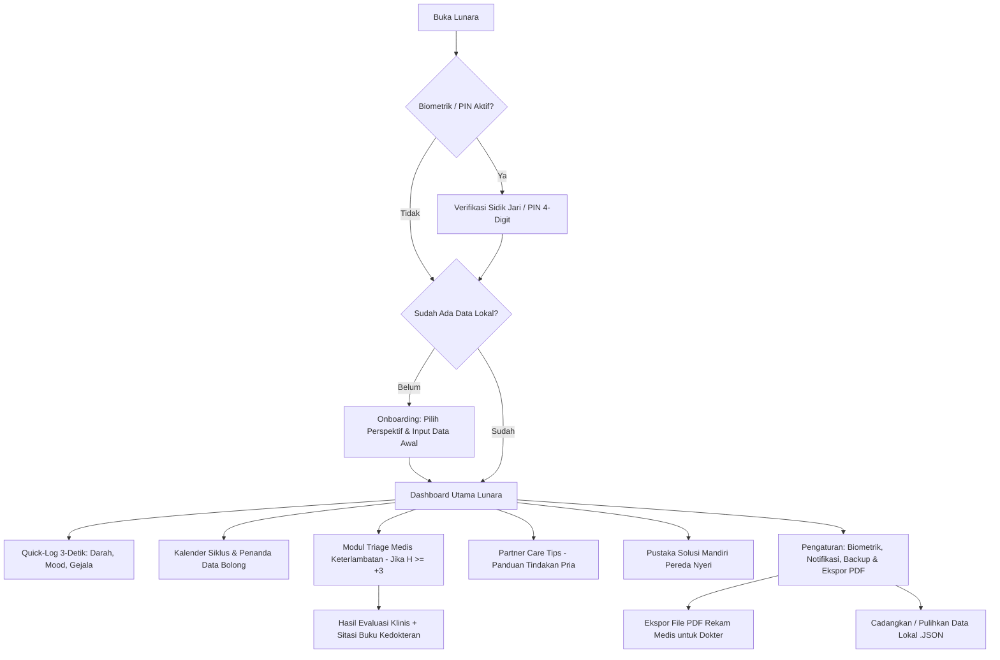

# Product Requirements Document (PRD)
# Lunara: Local-First Period, Health & Evidence-Based Companion

- **Nama Resmi Produk**: **Lunara**
- **Platform**: Flutter (Android Focus)
- **Arsitektur**: **100% Local-First (Tanpa Cloud / Serverless)**
- **Penyimpanan Lokal**: Hive / Isar / SQLite (Data tersimpan aman di perangkat)
- **Model Distribusi**: Private Use Only (Personal APK Build)
- **Status Dokumen**: Approved & Complete (v2.2: Biometrik, Notifikasi Lokal, PDF Export & Pustaka Mandiri)
- **Versi**: 2.2.0
- **Terakhir Diperbarui**: September 2026

---

## 1. Ringkasan Eksekutif (Executive Summary)
**Lunara** adalah aplikasi pelacak siklus menstruasi dan pendamping kesehatan reproduksi berbasis Flutter (Android) yang beroperasi **100% secara lokal (*Local-First*)** tanpa ketergantungan cloud, akun server, maupun koneksi internet. 

Aplikasi dirancang fleksibel untuk dioperasikan dalam **satu perangkat**: baik digunakan langsung oleh sang perempuan secara mandiri, maupun digunakan oleh pasangan pria yang berinisiatif membantu mencatatkan siklus serta memantau kondisi fisik dan emosional pasangannya. 

Fokus diferensiasi utama Lunara:
1. **Analisis Keterlambatan Berbasis Bukti Medis (*Evidence-Based Delay Triage*)**: Menggunakan pohon keputusan deterministik berdasarkan buku teks kedokteran resmi (ACOG, Speroff, Guyton & Hall, WHO), bukan tebak-tebakan atau halusinasi AI.
2. **Penanganan Data Historis & Siklus Bolong (*Smart Gap Handling*)**: Pengguna dapat memasukkan riwayat haid bulan-bulan sebelumnya (backfill), dan sistem secara cerdas menyaring siklus yang bolong/lupa dicatat agar prediksi tidak rusak.
3. **Privasi & Keamanan Tingkat Tinggi**: Dilengkapi kunci aplikasi biometrik (sidik jari / PIN) agar data intim tidak terbaca orang lain saat ponsel dipinjam.
4. **Alat Pendukung Lengkap**: Notifikasi pengingat lokal tanpa kuota/internet, pencetakan ringkasan siklus medis dalam format PDF untuk konsultasi ke dokter Sp.OG, serta Pustaka Solusi Mandiri pereda kram/nyeri berbasis sains.

---

## 2. Pernyataan Masalah (Problem Statement)
1. **Rekomendasi Tanpa Dasar Ilmiah**: Banyak aplikasi di pasaran memberikan saran umum tanpa rujukan medis yang transparan. Pengguna membutuhkan kepastian bahwa saran yang diberikan memiliki dasar biologis resmi.
2. **Kekosongan Data Masa Lalu & Siklus Bolong**: Pengguna wanita sudah mengalami menstruasi bertahun-tahun sebelum memasang aplikasi. Ketika mulai menggunakan aplikasi baru, riwayat lama sering tidak tercatat rapi, atau ada bulan yang terlupa (misalnya Januari ada, Februari lupa catat, Maret ada). Aplikasi yang buruk akan salah menghitung jarak 60 hari sebagai 1 siklus, merusak akurasi selamanya.
3. **Isu Privasi Data Kesehatan Menstruasi**: Data siklus menstruasi adalah data pribadi yang sangat sensitif. Menyimpannya di server online berisiko kebocoran data, sementara membiarkannya terbuka di ponsel berisiko diintip saat ponsel dipinjam.
4. **Kebingungan Menghadapi Nyeri & Kebutuhan Konsultasi Dokter**: Saat kram menstruasi hebat datang, pasangan sering bingung tindakan pertolongan pertama apa yang aman. Selain itu, saat periksa ke dokter kandungan (Sp.OG), pengguna sering lupa detail siklus 6 bulan terakhir.

---

## 3. Visi & Nilai Utama Lunara
- **Ilmiah & Terverifikasi (Evidence-Based)**: Setiap rekomendasi dan analisis penyebab telat haid memiliki data dan sitasi literatur medis yang jelas.
- **Toleran Terhadap Data Bolong (Fault-Tolerant Algorithm)**: Algoritma mengenali mana siklus normal, mana siklus terlewat (lupa catat), dan mana keterlambatan nyata.
- **100% Offline & Privat**: Bekerja instan tanpa koneksi internet, tanpa login email, dan dilindungi sensor biometrik lokal.
- **Single-Device Dual-Perspective**: Satu aplikasi yang bisa disesuaikan apakah yang mengoperasikan adalah sang wanita sendiri atau pria yang membantu mencatatkannya.

---

## 4. Target Pengguna & Mode Perspektif (Single-Device Operating Modes)

### Mode A: "Saya Mencatat untuk Diri Sendiri" (Perspektif Wanita)
- Fokus pada pencatatan harian kilat (*Quick-Log 3-Detik*), prediksi periode berikutnya, penjelasan fase tubuh, modul triage jika haid terlambat, dan pustaka solusi pereda nyeri.

### Mode B: "Saya Membantu Mencatatkan Pasangan Saya" (Perspektif Pasangan Pria)
- Menampilkan nama panggilan pasangan di dashboard utama.
- Menyediakan tombol cepat bagi pria untuk menginput status haid pasangannya saat diberitahu ("Dia mulai haid hari ini").
- Menampilkan **Kotak Panduan Pendamping (*Partner Care Guide*)** di bagian atas: Do's & Don'ts harian, panduan empati, dan tips merawat pasangan saat sedang kram.

---

## 5. Basis Data Medis & Pustaka Solusi Mandiri (Clinical Standards)

### A. Tabel Parameter Medis
| Topik Kesehatan | Literatur Standar Emas | Parameter Medis yang Digunakan |
|---|---|---|
| **Rentang Siklus Normal** | POGI & ACOG Practice Bulletin No. 219 | Durasi siklus normal: **21 – 35 hari** (rata-rata 28 hari). Variasi $\pm 2$ hingga $4$ hari antar siklus adalah fisiologis normal. |
| **Durasi Perdarahan Normal** | POGI & WHO Reproductive Health | Durasi normal: **2 – 7 hari**. Perdarahan $>8$ hari atau $<2$ hari ditandai untuk evaluasi. |
| **Suasana Hati & PMS/PMDD** | NICE Clinical Guidelines NG88 | Evaluasi fluktuasi mood fase Luteal: membedakan reaksi fisiologis wajar vs gejala disforia berat (PMDD). |
| **Penyebab Telat: Stres Akut** | Speroff's *Gynecologic Endocrinology* (Bab 11) | Hormon stres (kortisol & CRH) menekan pelepasan pulsatil hormon GnRH di hipotalamus, menunda lonjakan LH sehingga ovulasi tertunda. |
| **Penyebab Telat: Nutrisi & Diet** | ACOG Bulletin 219 & Guyton Hall (Bab 82) | Defisit kalori drastis menurunkan leptin, memicu *Functional Hypothalamic Amenorrhea* (tubuh menghemat energi reproduksi). |
| **Kapan Wajib Tes Kehamilan** | ACOG Patient FAQ 005 | Tes urin kehamilan (hCG) akurat dilakukan sejak **hari pertama terlambat haid** ($H+1$ dari estimasi siklus normal). |
| **Tanda Bahaya (*Red Flags*)** | POGI, ACOG & RCOG Emergency Guidelines | Keterlambatan $\ge 90$ hari (amenore sekunder) ATAU disertai nyeri panggul hebat unilateral mewajibkan pemeriksaan fisik ke dokter Sp.OG. |

### B. Pustaka Solusi Mandiri Pereda Nyeri & Kram (Evidence-Based Home Remedies)
- **Mekanisme Biologis Kram (Dismenore Primer)**: Terjadi akibat pelepasan hormon lokal *prostaglandin F2-alpha* ($PGF_{2\alpha}$) di endometrium yang memicu kontraksi otot miometrium rahim dan iskemia sementara (Guyton & Hall, Bab 82).
- **Intervensi Berbasis Riset Tanpa Obat**:
  1. **Terapi Hangat Lokal ($40^\circ\text{C}$)**: Kompres hangat di perut bawah meningkatkan aliran darah uterus; efektivitasnya terbukti setara dengan terapi obat pereda nyeri menurut studi klinis ACOG.
  2. **Asupan Magnesium & Vitamin B6**: Membantu relaksasi tonus otot rahim dan menstabilkan fluktuasi neurotransmiter mood.
  3. **Hidrasi & Teh Herbal**: Teh jahe (*Zingiber officinale*) terbukti menghambat jalur biosintesis prostaglandin secara alami.

---

## 6. Logika Penanganan Data Historis & Data Bolong (Gap Handling Algorithm)

### 1. Fitur Input Riwayat Masa Lalu (Historical Backfill)
- Pengguna dapat memasukkan riwayat siklus bulan-bulan sebelumnya yang masih diingat saat onboarding atau di kalender.

### 2. Algoritma Deteksi Data Bolong (*Outlier & Gap Filtering*)
- **Pendeteksian Gap**: Jika jarak antara 2 tanggal mulai haid adalah **$> 45$ hari**, sistem mendeteksi ini sebagai **Kemungkinan Data Terlewat / Lupa Catat**, bukan 1 siklus tunggal.
- **Penyaringan Otomatis**: Jeda bolong tersebut **DIKECUALIKAN dari rumus rata-rata siklus**, sehingga prediksi bulan berikutnya tidak rusak.
- **Penanda Kalender**: Periode yang bolong diberi penanda garis putus-putus dengan opsi pelengkapan data kapan saja.

---

## 7. Diagram Alur Layar (Screen Flow)



---

## 8. Persyaratan Fungsional (Functional Requirements)

| ID | Modul | Deskripsi Persyaratan | Prioritas |
|---|---|---|---|
| **FR-001** | Setup & Onboarding | Memilih perspektif pengguna (Wanita / Pria Membantu) dan mengisi tanggal haid terakhir tanpa akun. | P0 (Must) |
| **FR-002** | Input Data Lampau | Pengguna dapat menambahkan riwayat menstruasi bulan-bulan sebelumnya secara bebas di kalender. | P0 (Must) |
| **FR-003** | Gap & Outlier Filter | Siklus dengan jeda $>45$ hari otomatis diidentifikasi sebagai data bolong dan dikecualikan dari perhitungan rata-rata siklus. | P0 (Must) |
| **FR-004** | Quick-Log 3-Detik | Pencatatan harian kilat: Volume Darah (Spotting, Ringan, Sedang, Banyak, Selesai), Mood, dan Gejala Fisik. | P0 (Must) |
| **FR-005** | Edukasi 4 Fase | Menampilkan fase aktif harian (Menstruasi, Folikular, Ovulasi, Luteal) dengan penjelasan biologis awam. | P0 (Must) |
| **FR-006** | Partner Care Guide | Menampilkan kartu panduan Do's & Don'ts harian untuk pasangan pria saat mode "Membantu Pasangan" aktif. | P0 (Must) |
| **FR-007** | Smart Delay Triage | Menampilkan kuesioner triage 1 menit saat siklus terlambat $\ge 3$ hari dari estimasi. | P0 (Must) |
| **FR-008** | Badge Dasar Medis | Setiap analisis keterlambatan dan tips fase memiliki badge yang dapat dibuka untuk melihat rujukan buku kedokteran (ACOG, Speroff, Guyton & Hall). | P0 (Must) |
| **FR-009** | Alert Red Flag | Banner peringatan darurat jika terdapat gejala bahaya klinis (nyeri hebat, telat $>90$ hari). | P0 (Must) |
| **FR-010** | Catatan Retroaktif | Pengguna dapat mencatat atau mengedit tanggal mulai menstruasi ke hari-hari sebelumnya dengan mudah. | P0 (Must) |
| **FR-011** | Local Storage Engine | Data tersimpan 100% di memori lokal ponsel (Hive/SQLite) tanpa cloud. | P0 (Must) |
| **FR-012** | **Kunci Biometrik & PIN** | Opsi mengunci aplikasi menggunakan Sidik Jari / Biometrik Android atau PIN 4-digit (`local_auth`). | P0 (Must) |
| **FR-013** | **Notifikasi Lokal Pintar** | Alarm notifikasi offline Android (`flutter_local_notifications`): H-2 sebelum haid, pengingat fase PMS, dan alert keterlambatan. | P0 (Must) |
| **FR-014** | **Ekspor PDF Rekam Medis** | Menghasilkan berkas PDF rapi 1 halaman berisi riwayat 6 bulan, rata-rata siklus, dan keluhan untuk ditunjukkan ke dokter Sp.OG. | P0 (Must) |
| **FR-015** | **Pustaka Solusi Mandiri** | Modul edukasi pereda nyeri/kram (kompres hangat, nutrisi, teh herbal, relaksasi otot) berbasis riset ginekologi. | P0 (Must) |
| **FR-016** | **Cadangkan Data (.JSON)** | Fitur ekspor dan impor berkas data lokal `.json` untuk cadangan data saat berganti perangkat. | P1 (Should) |
| **FR-017** | **Grafik Statistik & Tren Siklus** | Visualisasi canvas bar chart riwayat panjang siklus 6 bulan, skor keteraturan ACOG Bulletin 219, frekuensi gejala fisik, distribusi mood, dan statistik keintiman. | P0 (Must) |

---

## 9. Persyaratan Non-Fungsional (Non-Functional Requirements)
- **NFR-001 (Kemandirian Total)**: Seluruh fitur (termasuk kalkulasi siklus, biometrik, notifikasi lokal, dan pembuatan PDF) dapat beroperasi tanpa sambungan internet.
- **NFR-002 (Keamanan Lokal)**: Data sensitif yang diekspor ke cadangan `.json` dienkripsi secara lokal.
- **NFR-003 (Kecepatan & Responsif)**: Validasi biometrik berhasil dalam $<500\text{ ms}$, pembukaan aplikasi $<1.5$ detik.
- **NFR-004 (Efisiensi Baterai)**: Notifikasi lokal menggunakan Android Exact Alarm API yang hemat daya.

---

## 10. Kriteria Penerimaan Tambahan (Acceptance Criteria)

### Skenario: Kunci Biometrik Saat Membuka Aplikasi
```gherkin
Given pengguna telah mengaktifkan fitur Kunci Biometrik di pengaturan
When pengguna menutup aplikasi dan membukanya kembali
Then sistem menampilkan prompt autentikasi sidik jari bawaan Android
And dashboard utama hanya terbuka setelah sidik jari terverifikasi sah
```

### Skenario: Ekspor PDF Rekam Medis untuk Dokter Sp.OG
```gherkin
Given pengguna memiliki riwayat catatan siklus minimal 1 bulan
When pengguna menekan tombol "Cetak Ringkasan Siklus (PDF)" di pengaturan
Then sistem menghasilkan dokumen PDF berisi: HPHT, rata-rata panjang siklus, grafik keteraturan, dan catatan keluhan
And pengguna dapat langsung membagikan file PDF tersebut via WhatsApp atau menyimpannya di file manager
```

### Skenario: Grafik Statistik & Tren Siklus (ACOG Bulletin 219)
```gherkin
Given pengguna telah mencatat riwayat siklus menstruasi di Lunara
When pengguna membuka kartu "Analisis & Tren Siklus" di Beranda atau tombol grafik di Kalender
Then sistem menyajikan grafik visual panjang siklus 6 bulan terakhir dengan rentang fisiologis normal (21–35 hari)
And sistem mengevaluasi skor keteraturan berdasarkan standar ACOG Bulletin No. 219 (sangat teratur <= 4 hari, teratur <= 9 hari)
And sistem menampilkan 3 gejala fisik terbanyak dengan penjelasan patofisiologi prostaglandin serta statistik keintiman
```

