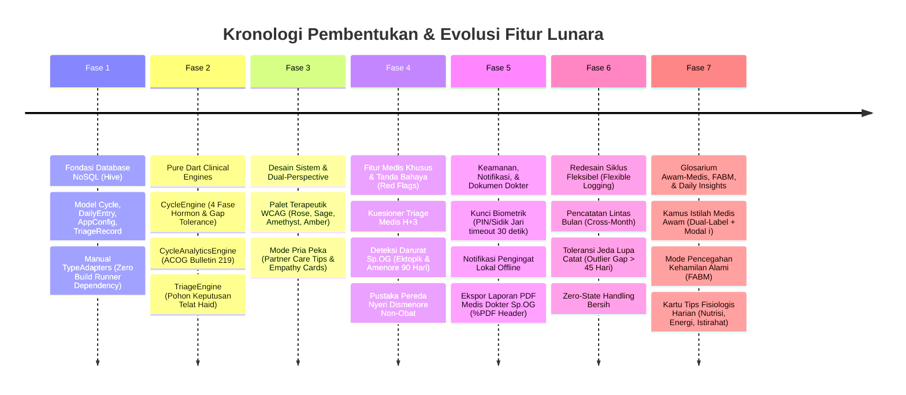
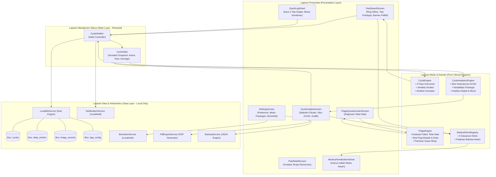
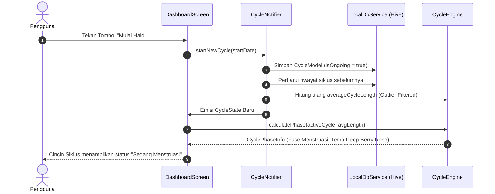
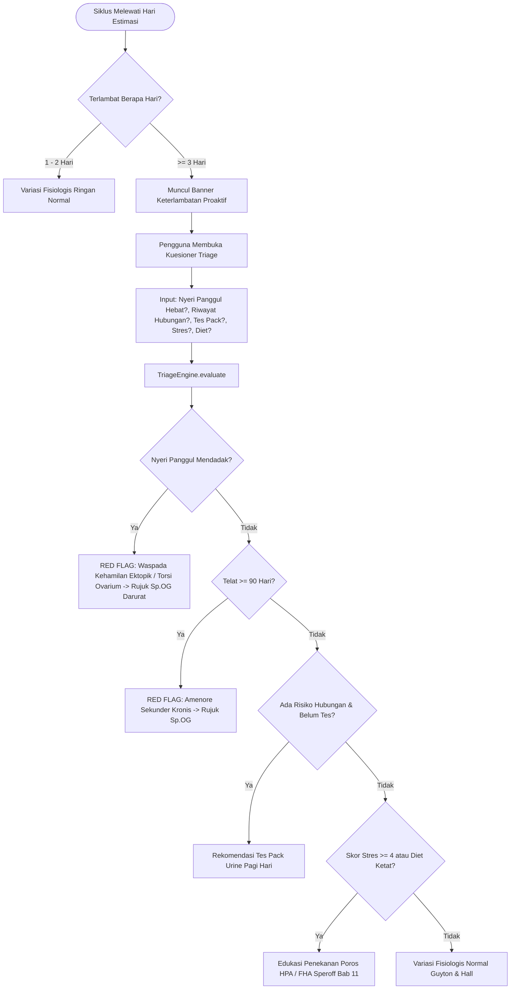
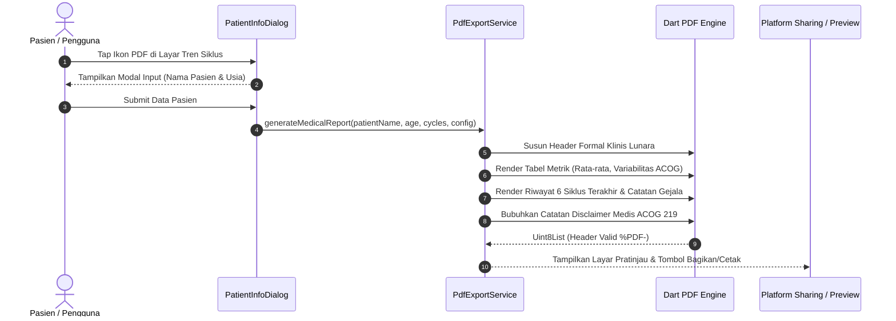

# Arsitektur Lengkap Lunara: Dari Konsep Awal Hingga Aplikasi Final

Dokumen ini mendokumentasikan secara komprehensif seluruh arsitektur sistem, evolusi pembentukan, lapisan teknis, alur data (*data flows*), dan landasan medis aplikasi **Lunara**.

---

## 1. Visi & Filosofi Rekayasa Produk

Lunara dirancang sebagai instrumen kesehatan reproduksi wanita yang menggabungkan presisi medis klinis dengan privasi mutlak dan empati humanis:

1. **Privasi Penuh (*Zero-Knowledge & Offline-First*)**:
   Data siklus haid, suasana hati, dan keintiman adalah data medis paling sensitif. Seluruh data diproses dan disimpan 100% di ruang penyimpanan lokal perangkat (Hive NoSQL). Tidak ada akun pengguna, tidak ada *tracking* pihak ketiga, dan tidak ada server *cloud* eksternal.
2. **Deterministik Medis Berbasis Bukti (*Evidence-Based Determinism*)**:
   Tidak menggunakan tebakan acak atau model AI yang berisiko halusinasi klinis. Seluruh rumus fisiologis, masa subur, skor keteraturan, dan pohon keputusan medis diturunkan langsung dari literatur baku:
   * **POGI (Perkumpulan Obstetri & Ginekologi Indonesia)**: Konsensus nasional tata laksana gangguan haid, dismenore, dan rujukan klinis dokter spesialis kandungan Indonesia.
   * **ACOG Practice Bulletin No. 219 & WHO**: Standar keteraturan siklus dan variabilitas fisiologis normal.
   * **NICE Clinical Guidelines NG88 (UK)**: Diagnosis dan manajemen *Premenstrual Syndrome (PMS)* dan *Premenstrual Dysphoric Disorder (PMDD)*.
   * **Guyton & Hall Fisiologi Kedokteran (Bab 82)**: Model 4 fase hormonal dan dinamika ovulasi.
   * **Speroff Clinical Gynecologic Endocrinology (Bab 11)**: Penilaian amenore sekunder dan poros HPO/HPA.
3. **Dual-Perspective & Dual-Goal**:
   * *Perspektif:* Ruang pribadi wanita (*Female Self*) dan mode pendamping pasangan (*Male Helper*).
   * *Tujuan:* Pemantauan kesehatan umum (*Health Tracking*) dan pencegahan kehamilan alami (*Natural Contraception / FABM*).

---

## 2. Peta Evolusi Pembentukan (Genesis Timeline)



---

## 3. Diagram Arsitektur Berlapis (Layered Architecture Diagram)

Arsitektur Lunara mengadopsi pola *Clean Layered Architecture* dengan pemisahan tanggung jawab yang ketat:



---

## 4. Alur Kerja & Siklus Hidup Data (Data Flow Lifecycle)

### Alur 1: Pencatatan Siklus Normal & Kalkulasi Fisiologis
Alur ketika pengguna mencatat haid, menyelesaikan haid, dan melihat status fase tubuh:



---

### Alur 2: Evaluasi Keterlambatan Haid & Skrining Triage Klinis
Alur ketika siklus pengguna terlambat melewati tanggal estimasi normal:



---

### Alur 3: Mode Pencegahan Kehamilan Alami (Metode FABM)
Alur penentuan status risiko konsepsi saat mode pencegahan alami aktif:

```mermaid
flowchart TD
    START_FABM[Pengguna Mengaktifkan Mode FABM di Pengaturan] --> SAVE_CONFIG[AppConfigModel.appGoal = natural_contraception]
    SAVE_CONFIG --> DASHBOARD_LOAD[DashboardScreen Membaca Status Siklus]
    
    DASHBOARD_LOAD --> CHECK_ACTIVE{Ada Siklus Aktif?}
    CHECK_ACTIVE -->|Tidak| ZERO_STATE[Tampilkan Status: Siap Catat Siklus]
    CHECK_ACTIVE -->|Ya| CHECK_BLEEDING{Sedang Perdarahan Haid?}
    
    CHECK_BLEEDING -->|Ya| MENSTRUAL_SAFE[Status: 🩸 Menstruasi — Risiko Konsepsi Minimal]
    CHECK_BLEEDING -->|Tidak| CALC_WINDOW[CycleEngine.isDateInFertileWindow<br/>Target: Hari Ini | Ovulasi: Siklus - 14 Hari]
    
    CALC_WINDOW --> CHECK_FERTILE{Hari Ini Berada di H-5 s/d H+1 Ovulasi?}
    
    CHECK_FERTILE -->|Ya| HIGH_RISK[Badge: ⚠️ Zona Subur — Risiko Tinggi<br/>Warna: Amethyst / Oranye<br/>Aksi: Hindari penetrasi tanpa proteksi / gunakan kondom]
    
    CHECK_FERTILE -->|Tidak| LOW_RISK[Badge: 🛡️ Fase Rendah Risiko<br/>Warna: Sage Mint Herbal<br/>Aksi: Peluang pembuahan minimal menurut kalender]
```

---

### Alur 4: Ekspor Dokumen Medis PDF Dokter Sp.OG
Alur pembuatan rekam medis cetak satu halaman untuk konsultasi klinis:



---

## 5. Peta Struktur Folder & Modul Codebase

```text
lib/
├── core/
│   ├── constants/
│   │   └── medical_constants.dart       # Ambang batas klinis (21-35h, jeda 45h, telat 3h, 90h)
│   ├── database/
│   │   ├── local_db_service.dart        # Pengelola singleton kotak penyimpanan Hive
│   │   └── models/
│   │       ├── app_config_model.dart    # Konfigurasi mode, biometrik, & tujuan FABM
│   │       ├── cycle_model.dart         # Entitas siklus, tanggal selesai, & jeda bolong
│   │       ├── daily_entry_model.dart   # Entitas log harian (gejala, mood, keintiman)
│   │       └── triage_record_model.dart # Riwayat hasil skrining telat haid
│   ├── services/
│   │   ├── backup_service.dart          # Ekspor & impor cadangan format JSON lokal
│   │   ├── biometric_service.dart       # Pengunci keamanan biometrik (PIN/Fingerprint)
│   │   ├── cycle_analytics_engine.dart  # Mesin statistik keteraturan ACOG Bulletin 219
│   │   ├── cycle_engine.dart            # Mesin fisiologi 4 fase Guyton & Hall & ovulasi
│   │   ├── notification_service.dart    # Penjadwal notifikasi pengingat lokal offline
│   │   ├── pdf_export_service.dart      # Generator berkas PDF laporan dokter Sp.OG
│   │   ├── sound_service.dart           # Pemutar nada denting santai sambutan
│   │   └── triage_engine.dart           # Pohon keputusan klinis keterlambatan siklus
│   ├── theme/
│   │   ├── app_colors.dart              # Palet warna terapeutik bersertifikasi kontras
│   │   ├── app_theme.dart               # Konfigurasi tema Material 3 global
│   │   └── app_typography.dart          # Skala tipografi Plus Jakarta Sans
│   └── widgets/
│       └── medical_term_bottom_sheet.dart # Kamus glosarium medis awam interaktif (ℹ️)
│
├── features/
│   ├── dashboard/
│   │   └── presentation/
│   │       ├── cycle_insights_screen.dart # Layar statistik & tren siklus ACOG
│   │       └── dashboard_screen.dart      # Dasbor utama, cincin siklus, & tips harian
│   ├── onboarding/
│   │   └── presentation/
│   │       └── onboarding_screen.dart     # Pengenalan awal & pemilihan perspektif
│   ├── pain_relief/
│   │   └── presentation/
│   │       └── pain_relief_screen.dart    # Pustaka 4 terapi pereda dismenore non-obat
│   ├── pdf_export/
│   │   └── presentation/
│   │       ├── patient_info_dialog.dart   # Dialog masukan nama pasien cetak PDF
│   │       └── pdf_preview_screen.dart    # Layar pratinjau dokumen PDF laporan dokter
│   ├── quick_log/
│   │   └── presentation/
│   │       └── quick_log_sheet.dart       # Lembar input cepat gejala harian
│   ├── settings/
│   │   └── presentation/
│   │       ├── legal_info_sheets.dart     # Lembar kebijakan privasi & ketentuan medis
│   │       └── settings_screen.dart       # Layar konfigurasi fitur, FABM, & data
│   ├── tracker/
│   │   └── state/
│   │       ├── cycle_notifier.dart        # Pengelola mutasi status siklus (Riverpod)
│   │       └── cycle_state.dart           # Immutabel snapshot data siklus
│   └── triage_delay/
│       └── presentation/
│           └── triage_questionnaire_screen.dart # Kuesioner interaktif evaluasi telat haid
│
└── main.dart                            # Titik masuk utama aplikasi (Inisialisasi Hive)
```

---

## 6. Jaminan Mutu & Rangkaian Pengujian (*Quality Assurance*)

Aplikasi diproteksi dengan rangkaian pengujian otomatis (*automated tests*) yang memverifikasi setiap lapisan logika:

| Berkas Pengujian | Area yang Diuji | Standar Medis / Fungsional |
| :--- | :--- | :--- |
| `cycle_engine_test.dart` | 4 fase siklus, perkiraan tanggal haid, deteksi jeda bolong (*outlier gap* > 45h). | Guyton & Hall Bab 82 |
| `cycle_analytics_test.dart` | Klasifikasi keteraturan siklus (*very regular, regular, moderate, irregular*). | ACOG Bulletin No. 219 |
| `triage_engine_test.dart` | Deteksi bahaya ektopik (*severe pelvic pain*), amenore 90 hari, evaluasi stres & diet. | Speroff Bab 11 & ACOG |
| `flexible_cycle_redesign_test.dart` | Pencatatan fleksibel, haid lintas bulan, analisis konsepsi retroaktif, dan isolasi log. | Validasi Kalender Nyata |
| `phase5_security_notification_test.dart` | Batas timeout kunci biometrik (30 detik) dan tanggal evaluasi notifikasi H+3. | Keamanan & Penjadwalan |
| `phase6_7_release_test.dart` | Keabsahan Magic Bytes PDF (`%PDF-`) dan integritas skema cadangan JSON. | ISO 32000-1 (PDF Spec) |
| `medical_glossary_and_goal_test.dart` | Kelengkapan 9 kamus istilah medis awam dan serialisasi tujuan FABM. | Desain Sistem & Kamus |

**Tingkat Kelulusan Pengujian:** **50 / 50 Tests Passed (100% Green)**.
